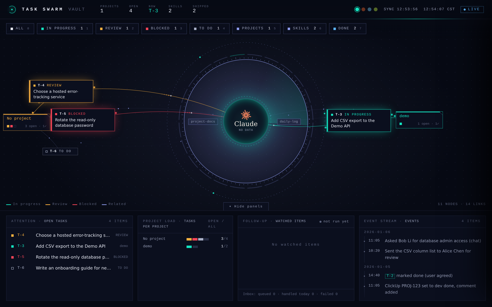
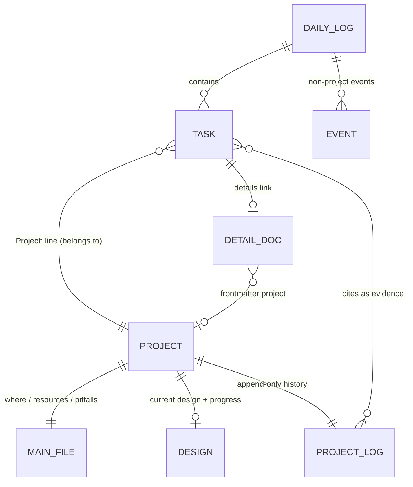

# agent-work-vault

[中文](README.zh-CN.md)

A work vault you run together with an AI agent: one Git repository that is at once an [Obsidian](https://obsidian.md) vault and a [Claude Code](https://claude.com/claude-code) project. You talk to the agent; it keeps your daily task log, your project files and your notes in shape by following the rules written in `CLAUDE.md` and a few skills, and a set of small scripts and a linter keep everything checkable.



It grew out of a real working setup used every day by a backend engineer, with everything personal and company-specific stripped out.

## What you get

- **Daily log** (`task/YYYY-MM-DD.md`): a cross-project to-do list with statuses (not started / in progress / Review / blocked / done / cancelled), stable task IDs (`T-12`), reporter tags, plus a log and an event stream. The agent moves tasks to Review when it needs you, and never marks anything done without your consent.
- **Project files** (`projects/<project>.md` + `projects/<project>/`): where it runs and what it uses in the main file, design and progress in Design, an append-only project log for what happened when. Projects are indexed by their frontmatter, no index file to maintain.
- **Skills** (`skills/`): `daily-log` and `project-docs` teach the agent the formats; `bin/sync_skills.py` installs them as project skills. Add your own skills next to them.
- **Follow-up for blocked tasks** (`skills/follow-up`): when a task goes blocked, the agent checks whether the condition can be watched and offers to watch it. A background loop runs cheap watcher scripts (web pages and GitHub PRs included; add your own for Jira, Slack, email…) and only starts a cheaper model when a condition is met, to move the task back to in progress or to Review.
- **Cost-aware planning**: when planning a project, each milestone records who does it: you, the main agent, or a sub-agent on a cheaper model (Haiku / Sonnet) for well-scoped mechanical work.
- **Scripts** (`bin/`, Python standard library only): list unfinished tasks, summarize a day, list projects, a live task board, and `lint_vault.py`, which checks frontmatter, links, headings and task IDs and runs as a pre-commit hook.
- **Credentials stay out of the docs**: everything sensitive lives in a gitignored `asset/config.yaml`; docs only say where a credential is (`→ config.yaml: <key>`).
- **English and Chinese**: every rule file comes in both languages; the scripts understand headings in either.

## The design: projects and tasks as two aligned models

Most note systems mix "what I'm doing" and "what I know" in the same pages, and both rot. This vault keeps them as two separate kinds of entity with a fixed schema each, and aligns them through stable identifiers and one-way relations, much like two small ontologies mapped onto each other.

**"Project" and "task" are meant broadly.** A *project* is anything long-lived you keep knowledge about and return to: a software service, but just as well a customer account, a product line, a recurring process (hiring, month-end close, on-call), an area of responsibility, a body of research, even a house move. A *task* is any single piece of work with an end: fixing a bug, answering a request, preparing a meeting, making a decision, an errand. The test is not "is this a project in the project-management sense" but "will I come back to this subject and need to know where things are and what happened" (project) versus "is there something to get done" (task). The fixed sections of a project file are all optional, so a customer or a process fits as well as a server.


| | **Task** | **Project** |
| --- | --- | --- |
| Answers | What needs doing, and is it done? | What is this system, where is it, what happened to it? |
| Lifetime | Short: opened, worked, closed | Long: lives as long as the system |
| Identity | `T-N` (global, never reused) | File name, e.g. `demo` |
| Lives in | One line in `task/YYYY-MM-DD.md` (+ optional `task/details/` doc) | `projects/<name>.md` + `projects/<name>/` |
| Schema | Status checkbox, start/end time, ID, title, ticket number, `#reporter/`, `#type/` | Frontmatter (`name`, `description`, `aliases`, `repo`, `hosts`) + fixed sections |
| Changes by | Status transitions (todo → doing → Review / blocked → done) | Rewriting current state; appending history |



The alignment rules:

- **Every fact has exactly one home**, chosen by what kind of fact it is: what to follow when working → the project main file; how the system is *now* and the plan → Design; what happened *when* → the project log; whether something is done → the task line. Nothing is written twice.
- **Tasks point to projects, never the other way round.** A task names its project on a `Project:` line; project files don't list tasks (only the project log may cite one as evidence). Projects stay readable as knowledge after every task is long closed.
- **A project task stays thin.** Its progress and conclusions are recorded on the project side; the task line only tracks status. When a task finishes, the lasting knowledge has already landed in the project.
- **Two event streams, split by subject.** Changes to a system (deploys, config, decisions) go to its project log; communication and everything else go to the daily log's `## Events`. `bin/day_summary.py` joins both to answer "what did I do today".
- **The schema is enforced, not hoped for.** `lint_vault.py` checks frontmatter types, fixed sections, heading order, unique task IDs and link directions on every commit; `projects.py` and `unfinished_tasks.py` query the two models, and the board renders their joins.

## Task board

`bin/board.py` serves a live, read-only view of the vault: projects, unfinished tasks, skills and events as one graph (screenshot above).

```bash
python3 bin/board.py                     # open http://127.0.0.1:8765
python3 bin/board.py --quota-interval 0  # don't poll your Claude subscription quota
python3 bin/board.py --host 0.0.0.0 --port 9000   # reachable from other machines
```

- **Graph**: each project is a card; its unfinished tasks hang next to it, coloured by status (in progress, Review, blocked); tasks with no project gather under "No project". Skills sit inside the central Claude circle and are linked to the tasks and projects that mention them.
- **Filters**: the buttons on top (keys `0`–`7`) bring one group to the front, e.g. everything waiting for your Review. Esc restores.
- **Click** a task for its notes, detail doc and related project log entries; click a project for its summary, open tasks and recent log.
- **Panels** below: unfinished tasks, load per project, follow-up items (from `skills/follow-up`) and the event stream from your daily logs.
- **The Claude core** shows today's tokens and, unless `--quota-interval 0`, your remaining 5-hour / weekly quota; it reads token counts from `~/.claude/projects` locally and never reads conversation content.
- It watches the files and updates within a second, so keep it open in a browser tab while you work with the agent. Details in [bin/README.md](bin/README.md).

## Quick start

Requirements: Python 3.10+, Git, [Claude Code](https://claude.com/claude-code); Obsidian is optional but recommended.

**Have a GitHub account? Keep your vault in a private repository of your own.** Your vault will hold your work, so don't keep it public. GitHub doesn't let you make a fork of a public repository private, so instead:

- On this repository's page click **Use this template → Create a new repository**, choose **Private**, then clone your new repository; or
- mirror it into an empty private repository you created:

  ```bash
  git clone --bare https://github.com/hexhero/agent-work-vault.git
  git -C agent-work-vault.git push --mirror https://github.com/<you>/<your-private-vault>.git
  rm -rf agent-work-vault.git
  ```

To pick up later improvements, add this repository as `upstream` in your copy and merge from it now and then (`git remote add upstream https://github.com/hexhero/agent-work-vault.git`, then `git fetch upstream && git merge upstream/main`; a copy made from the template needs `--allow-unrelated-histories` the first time).

Then set it up:

```bash
git clone https://github.com/<you>/<your-private-vault>.git my-vault   # or this repository, to just try it
cd my-vault
python3 bin/setup.py --lang en --timezone Europe/Berlin --examples   # or --lang zh-CN
```

Then:

1. Fill in `PROFILE.md` (who you are, time zone, preferences) and `asset/services.md` (servers and services you use). Copy `asset/config.example.yaml` to `asset/config.yaml` for credentials.
2. Open the folder in Claude Code and say things like "record a task: …", "what's still open?", "I deployed demo v1.3 to production, log it", "create a project file for …".
3. Open the folder in Obsidian to browse the graph and the `overview.base` views. Run `python3 bin/board.py` for the task board.
4. `--examples` installed a demo project and two days of logs; delete them (`projects/demo*`, `task/2026-01-0*`, `task/details/error-tracking.md`) when you no longer need them.

## Layout

```
.
├── CLAUDE.md          Rules the agent follows (loaded every session)
├── PROFILE.md         About you (loaded every session)
├── projects/          One file per project, plus a same-name folder for Design and the project log
├── task/              Daily logs, task details, temp files (gitignored)
├── docs/              Long-lived guides and research notes
├── skills/            Skills (source); .claude/skills/ holds the generated entries
├── bin/               Scripts, see bin/README.md
├── asset/             Service list, credentials (config.yaml is gitignored)
├── examples/          Demo project and daily logs in each language
├── i18n/              The rule files in each language (bin/setup.py --lang switches)
└── vault.config.json  Language and time zone for the scripts
```

## Status and limitations

- Command-line output and code comments of the scripts are in Chinese for now; the task board, docs, rules and skills are in English.
- The follow-up loop needs Claude Code installed and logged in on the machine that runs it (it starts `claude -p`), and watchers for the systems you want to watch.

## License

[MIT](LICENSE)
