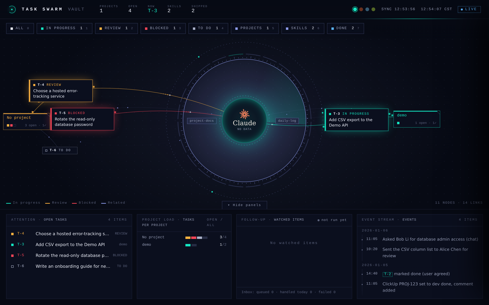
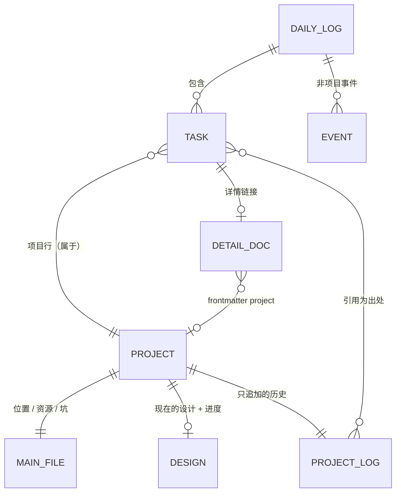

# agent-work-vault

[English](README.md)

和 AI agent 一起用的工作知识库：一个 Git 仓库，同时是 [Obsidian](https://obsidian.md) vault 和 [Claude Code](https://claude.com/claude-code) 项目。你跟 agent 说话，它按 `CLAUDE.md` 和几个 skill 里写的规则，帮你维护每日任务日志、项目文件和笔记；几个小脚本和 lint 保证这些东西都能检查。



它来自一位后端工程师每天在用的真实工作环境，去掉了所有个人和公司的内容。

## 有什么

- **每日日志**（`task/YYYY-MM-DD.md`）：跨项目的待办清单，带状态（未开始 / 进行中 / Review / Block / 完成 / 取消）、稳定的任务编号（`T-12`）、报告人标签，另有日志和事件流。agent 需要你决定时把任务推到 Review，没有你同意不会标记完成。
- **项目文件**（`projects/<项目>.md` 加 `projects/<项目>/`）：主文件写在哪、用到什么；Design 写设计和进度；只追加的项目日志记什么时候发生了什么。项目靠 frontmatter 索引，不用维护索引文件。
- **Skill**（`skills/`）：`daily-log`、`project-docs` 教 agent 这些格式；`bin/sync_skills.py` 把它们装成项目 skill。你自己的 skill 放在旁边就行。
- **卡住的任务自动跟进**（`skills/follow-up`）：任务改成 Block 时，agent 会判断等的条件能不能盯，问你要不要盯。后台循环跑便宜的 watcher 脚本（自带网页和 GitHub PR 两个，Jira、Slack、邮件等自己加），条件满足了才启动便宜模型，把任务改回进行中或推到 Review。
- **规划时考虑成本**：规划项目时每个里程碑写明谁做：你、主 agent，还是用便宜模型（Haiku / Sonnet）的子 agent 做范围清楚的机械活。
- **脚本**（`bin/`，只用 Python 标准库）：列未完成任务、汇总某一天、列项目、实时任务看板，以及 `lint_vault.py`（查 frontmatter、链接、标题和任务编号，作为 pre-commit 钩子运行）。
- **凭据不进文档**：敏感信息都在 gitignore 掉的 `asset/config.yaml` 里，文档里只写存在哪（`→ config.yaml: <键>`）。
- **中英文**：规则文件都有中英两版，脚本两种语言的标题都认。

## 设计：项目和任务是两套对齐的模型

多数笔记系统把「我在做什么」和「我知道什么」写在同一页里，结果两样都会烂掉。这里把它们分成两类实体，各有固定的结构，再用稳定的标识和单向的关系对齐起来，像两个小本体之间做映射。

**「项目」和「任务」都是广义的。** *项目*是任何长期存在、要积累知识、会反复回来看的对象：可以是一个软件服务，也可以是一个客户、一条产品线、一套反复跑的流程（招聘、月结、值班）、一块负责的职责、一个研究方向，甚至一次搬家。*任务*是任何有终点的一件事：修一个 bug、回一个请求、准备一次会议、做一个决定、跑一趟腿。判断标准不是「这在项目管理意义上算不算项目」，而是「我会不会反复回到这个对象、需要知道它在哪、发生过什么」（项目），还是「有一件事要做完」（任务）。项目文件的固定小节都可以不写，所以客户、流程和服务器一样放得进来。


| | **任务（Task）** | **项目（Project）** |
| --- | --- | --- |
| 回答 | 要做什么、做完没有 | 这个系统是什么、在哪、发生过什么 |
| 生命周期 | 短：开、做、关 | 长：系统在它就在 |
| 标识 | `T-N`（全局递增，不复用） | 文件名，如 `demo` |
| 放在哪 | `task/YYYY-MM-DD.md` 里的一行（可另有 `task/details/` 文档） | `projects/<名字>.md` 加 `projects/<名字>/` |
| 结构 | 状态复选框、起止时间、编号、主题、工单号、`#reporter/`、`#type/` | frontmatter（`name`、`description`、`aliases`、`repo`、`hosts`）加固定小节 |
| 怎么变 | 状态流转（未开始 → 进行中 → Review / Block → 完成） | 现状原地改写；历史只追加 |



对齐的规则：

- **每条事实只有一个归宿**，按它是什么性质来定：干活时要照做的 → 项目主文件；系统「现在」什么样、计划 → Design；「什么时候」发生了什么 → 项目日志；做没做完 → 任务那一行。不写两遍。
- **任务指向项目，项目不指回任务。** 任务用「项目：」行写明属于哪个项目；项目文件不列任务（只有项目日志可以把任务当出处引用）。任务都关掉很久以后，项目文件读起来仍然是完整的知识。
- **项目型任务很薄。** 进展和结论记在项目那边，任务那一行只管状态；任务做完时，长期有用的东西已经落进项目里了。
- **两条事件流，按对象分。** 系统本身的变化（发版、改配置、定下来的事）进项目日志；沟通和其余的进每日日志的 `## 事件`。「今天干了什么」用 `bin/day_summary.py` 把两边合起来看。
- **结构靠检查保证，不靠自觉。** `lint_vault.py` 每次提交都查 frontmatter 类型、固定小节、标题顺序、任务编号唯一、链接方向；`projects.py`、`unfinished_tasks.py` 分别查两套模型，看板把它们的关联画出来。

## 任务看板

`bin/board.py` 起一个只读的实时页面，把项目、未完成任务、skill 和事件画成一张图（见上面的截图）。

```bash
python3 bin/board.py                     # 打开 http://127.0.0.1:8765
python3 bin/board.py --quota-interval 0  # 不查 Claude 订阅余量
python3 bin/board.py --host 0.0.0.0 --port 9000   # 让别的机器也能打开
```

- **关系图**：每个项目是一张卡片，未完成的任务挂在旁边，按状态着色（进行中、Review、Block）；没有项目的任务归到「No project」。skill 在中间的 Claude 圆里，连到提到它的任务和项目。
- **筛选**：上方的按钮（ALL / IN PROGRESS / REVIEW 等，键盘 `0`～`7`）把一类调到前景，比如所有等你 Review 的任务；按 Esc 还原。
- **点击**任务看补充说明、详情文档和相关的项目日志；点项目看简介、未完成任务和最近的日志。
- **下方面板**：未完成任务、各项目任务量、跟进项（来自 `skills/follow-up`）、每日日志里的事件流。
- **中间的 Claude 核心**显示今天的 token，没加 `--quota-interval 0` 时还显示近 5 小时 / 本周的余量；token 数从本机 `~/.claude/projects` 读，不读对话内容。
- 文件一改一秒内就刷新，和 agent 一起干活时开在浏览器标签页里就行。细节见 [bin/README.md](bin/README.md)。

## 上手

需要：Python 3.10+、Git、[Claude Code](https://claude.com/claude-code)；Obsidian 可选，建议装。

**有 GitHub 账号的，建议放进你自己的私有仓库。** 知识库里会记你的工作，不要公开。GitHub 不允许把公开仓库的 fork 改成私有，所以这样做：

- 在本仓库页面点 **Use this template → Create a new repository**，选 **Private**，再克隆你的新仓库；或者
- 先自己建一个空的私有仓库，再镜像推过去：

  ```bash
  git clone --bare https://github.com/hexhero/agent-work-vault.git
  git -C agent-work-vault.git push --mirror https://github.com/<你>/<你的私有仓库>.git
  rm -rf agent-work-vault.git
  ```

想跟上本仓库后续的改进：在你的副本里把本仓库加成 `upstream`，隔段时间合并一次（`git remote add upstream https://github.com/hexhero/agent-work-vault.git`，然后 `git fetch upstream && git merge upstream/main`；用 template 建的副本第一次合并要加 `--allow-unrelated-histories`）。

然后初始化：

```bash
git clone https://github.com/<你>/<你的私有仓库>.git my-vault   # 只想先试试，也可以直接克隆本仓库
cd my-vault
python3 bin/setup.py --lang zh-CN --timezone Asia/Shanghai --examples
```

然后：

1. 填好 `PROFILE.md`（你是谁、时区、偏好）和 `asset/services.md`（用到的服务器和服务）。凭据复制 `asset/config.example.yaml` 为 `asset/config.yaml` 再填。
2. 用 Claude Code 打开这个目录，说「记个任务：……」「还有哪些没做完」「demo v1.3 发生产了，记一下」「给……建个项目文件」。
3. 用 Obsidian 打开这个目录，看关系图和 `overview.base` 的视图。任务看板跑 `python3 bin/board.py`。
4. `--examples` 装了一个示例项目和两天的日志，不需要了就删掉（`projects/demo*`、`task/2026-01-0*`、`task/details/error-tracking.md`）。

## 目录

```
.
├── CLAUDE.md          agent 遵守的规则（每次会话加载）
├── PROFILE.md         关于你（每次会话加载）
├── projects/          一个项目一个文件，同名目录放 Design 和项目日志
├── task/              每日日志、任务详情、临时文件（已 gitignore）
├── docs/              长期的指南和调研
├── skills/            skill 源文件；.claude/skills/ 是生成的入口
├── bin/               脚本，见 bin/README.md
├── asset/             服务清单、凭据（config.yaml 已 gitignore）
├── examples/          各语言的示例项目和每日日志
├── i18n/              各语言的规则文件（bin/setup.py --lang 切换）
└── vault.config.json  脚本用的语言和时区
```

## 现状和限制

- 脚本的命令行输出和代码注释目前是中文；任务看板的界面是英文；文档、规则和 skill 中英文都齐。
- 跟进循环要在装好并登录了 Claude Code 的机器上跑（它会启动 `claude -p`），要盯的系统得有对应的 watcher。

## 许可证

[MIT](LICENSE)
